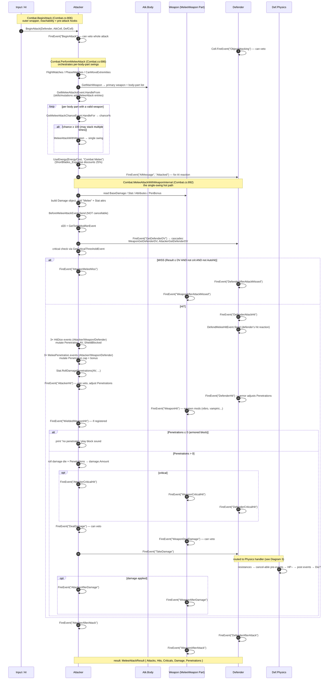
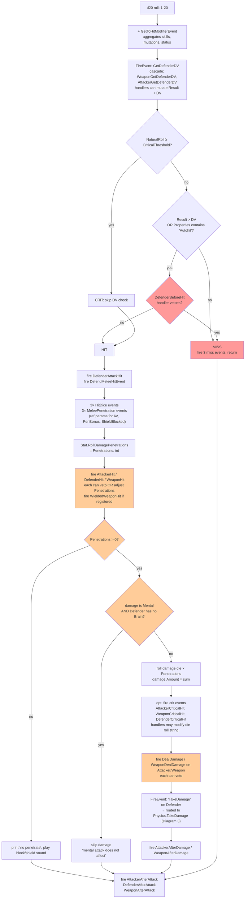
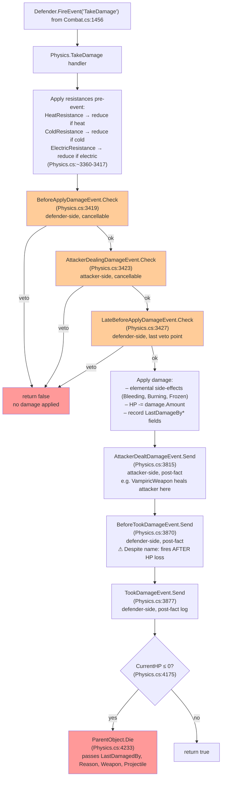

# Qud Vertical Trace — Combat Swing

> End-to-end trace of one melee attack in Caves of Qud, from the outer
> `BeginAttack` wrapper through the hit roll, damage roll, typed-event
> cascade, and death check. All file:line references point into
> `/Users/steven/qud-decompiled-project/` (the full 5368-file decompile).
> Read this in conjunction with `Docs/QUD-VERTICAL-CORE-ABSTRACTIONS.md`
> (if/when written) — this trace assumes you already understand the
> `GameObject` / `IPart` / `MinEvent` / dual-dispatch core.

---

## TL;DR — the seven things to internalize

1. **Three method layers** handle a swing. `Combat.BeginAttack` is the
   outer wrapper (`Combat.cs:806`), `Combat.PerformMeleeAttack` is the
   per-swing orchestrator (`Combat.cs:686`), and
   `Combat.MeleeAttackWithWeaponInternal` is where a single weapon's
   hit roll and damage roll live (`Combat.cs:892`).
2. **Damage application lives in `Physics.cs`, not `Combat.cs`.**
   Combat fires the string event `"TakeDamage"` on the defender
   (`Combat.cs:1456`); the defender's `Physics` Part handles it and
   runs the typed-event cascade plus HP subtraction
   (`Physics.cs:3419`-`3877`).
3. **30+ events fire per swing.** Most are dual-emitted — a legacy
   string event plus a pooled typed `MinEvent` subclass — so handlers
   can opt into either path.
4. **Naming convention is NOT a perfect veto/notification signal.**
   `BeforeMeleeAttackEvent.Send` returns void — handlers cannot cancel
   the attack ([BeforeMeleeAttackEvent.cs:38](../qud-decompiled-project/XRL.World/BeforeMeleeAttackEvent.cs)).
   `BeforeApplyDamageEvent.Check` and `AttackerDealingDamageEvent.Check`
   DO return bool and can veto. **You have to read each event to know.**
5. **`MeleeAttack` is a data carrier, not an entry point.** Pooled
   struct-like class describing one attack opportunity (chance, hit
   mod, weapon, body part). The list-collecting events
   `GetMeleeAttacksEvent` and `GetWeaponMeleeAttacksEvent` populate
   `List<MeleeAttack>` from skills, mutations, and weapon defaults.
6. **Penetration > 0 is what gates damage, not "did I hit?"** A hit
   that fails to penetrate prints "you don't penetrate the armor" and
   exits early. Penetrations are computed via
   `Stat.RollDamagePenetrations(AV, StatBonus, MaxPen)` after three
   `*HitDice*` events and three `*MeleePenetration*` events mutate the
   inputs (`Combat.cs:1087-1101`).
7. **The damage object is mutated all the way through.** Same
   `Damage` instance flies through the entire pipeline; handlers add
   attributes, mutate `.Amount`, or veto outright. By the time
   `TookDamageEvent.Send` fires, the final post-resistance damage is
   in `.Amount`.

---

## Diagram 1 — Full swing sequence



---

## Diagram 2 — Hit/damage branching flowchart



Color key — red: terminal paths; orange: branch decisions / cancel gates.

---

## Diagram 3 — Damage application close-up (Physics)

The defender's `Physics` Part owns the actual HP-subtraction pipeline.
It registers for the string event `"TakeDamage"` and translates it into
the typed-event cascade.



**Naming gotcha**: `BeforeTookDamage` fires AFTER HP subtraction
(`Physics.cs:3870` is after `Physics.cs:~3500-3800` where HP is
mutated). The name means "before the `TookDamage` event," not "before
damage is taken." `BeforeApplyDamage` / `LateBeforeApplyDamage` /
`AttackerDealingDamage` are the genuine pre-damage cancel points.

---

## Phase-by-phase breakdown

### Phase 0 — Outer wrapper: `Combat.BeginAttack`
[Combat.cs:806](../qud-decompiled-project/XRL.World.Parts/Combat.cs)

Called by the input system / AI before any per-body-part work.
Cancellable hooks fire here so listeners can fully veto an attack
before any state changes:

| Event | Side | Cancellable | Purpose |
|---|---|---|---|
| `"BeginAttack"` | Attacker | yes | gate intent (e.g., disable-attack effects) |
| `"ObjectAttacking"` | Defender's cell | yes | cell-level interception |

Also marks the defender's zone active if defender is player-led.

### Phase 1 — Reachability gates
[Combat.cs:688-705](../qud-decompiled-project/XRL.World.Parts/Combat.cs)

`FlightMatches` (flight altitude compat) → `PhaseMatches` (phased
through?) → `CanMoveExtremities("Attack")` (paralysis/restraint).
Each prints a player-facing message on fail and returns. Note:
`CanMoveExtremities` failing returns `true` — the swing "succeeded"
in the sense that energy may still be spent.

### Phase 2 — Gather attacks and body parts
[Combat.cs:706-737](../qud-decompiled-project/XRL.World.Parts/Combat.cs)

Two distinct concepts of "attacks":

- **Body-part-rooted attacks**: walk `Body.GetMainWeapon(...)` to get
  the primary weapon's body part and a list of all body parts that
  hold a valid weapon for this defender.
- **Skill/mutation-added attacks**: `GetMeleeAttacksEvent.HandleFrom(Attacker)`
  collects extra swings (e.g., StingerMutation adds a sting,
  Axe_HookAndDrag adds a follow-up). These live in `E.Attacks: List<MeleeAttack>`.

Body parts are then shuffled, primary-weapon part moved to index 0.
Each weapon is asked `FireEvent("CanMeleeAttack")` — if false, the
weapon is dropped from the list (think: chained, broken, locked).

### Phase 3 — Per-body-part attack loop
[Combat.cs:738-791](../qud-decompiled-project/XRL.World.Parts/Combat.cs)

For each body part with a weapon:
1. Fire `GetMeleeAttackChanceEvent.HandleFor(...)` → final chance to
   actually swing this body part. Can be > 100 (multi-swing).
2. While `chance > 0`: for `E2.Attempts` iterations, call
   `MeleeAttackWithWeapon` — each iteration is one full hit/damage
   resolution (Phase 4-8).
3. For each `MeleeAttack` from the skill/mutation list valid for this
   body part: fire another `GetMeleeAttackChanceEvent` and run more
   swings.

### Phase 4 — Single swing setup (in `MeleeAttackWithWeaponInternal`)
[Combat.cs:892-946](../qud-decompiled-project/XRL.World.Parts/Combat.cs)

Reads the weapon's `MeleeWeapon` Part:
- `BaseDamage` (die-roll string, e.g. `"1d4"`)
- `MaxStrengthBonus` (cap on stat-add to damage)
- `Stat` (which stat to use; comma-separated picks the highest, e.g. `"Strength,Agility"`)
- `Attributes` (damage types this weapon imparts: Slash, Pierce, Cold, ...)

If the stat is mental (Ego/Will/Intelligence), the damage is marked
`Mental` — handled specially in Phase 6.

`BeforeMeleeAttackEvent.Send` fires here. **Not cancellable.** Used
for adjustment-only hooks (skills like `LongBlades_Riposte` can react
but not stop the swing).

### Phase 5 — To-hit and crit
[Combat.cs:947-984](../qud-decompiled-project/XRL.World.Parts/Combat.cs)

```
roll = Stat.Random(1, 20)
mod  = GetToHitModifierEvent.GetFor(...)
result = roll + mod

GetDefenderDV → cascaded as 3 string events:
  Defender:  "GetDefenderDV"
  Weapon:    "WeaponGetDefenderDV"
  Attacker:  "AttackerGetDefenderDV"
  → each may mutate result, naturalRoll, DV

crit threshold = GetCriticalThresholdEvent.GetFor(...) - GetSpecialEffectChanceEvent("Melee Critical") adjustment
hit = naturalRoll ≥ crit OR result > DV OR Properties contains "Autohit"

if hit:
  hit &= Defender.FireEvent("DefenderBeforeHit")   ← last veto point
```

### Phase 6 — Miss path
[Combat.cs:997-1075](../qud-decompiled-project/XRL.World.Parts/Combat.cs)

CombatJuice animation if enabled, else `ParticleBlip`. Print player
message (with hit-result number bracketed for the player's
information). AutoAct interrupts if defender is in auto-mode and
attacker is relevant-hostile. Fire string events:

| Event | Side |
|---|---|
| `"AttackerMeleeMiss"` | Attacker |
| `"DefenderAfterAttackMissed"` | Defender |
| `"WeaponAfterAttackMissed"` | Weapon |

### Phase 7 — Hit confirmed; compute penetrations
[Combat.cs:1076-1141](../qud-decompiled-project/XRL.World.Parts/Combat.cs)

```
Defender.FireEvent("DefenderAttackHit")     -- defender's "I got hit" hook
DefendMeleeHitEvent.Send(...)               -- typed defender hit hook

AV = flag(Mental) ? Stats.GetCombatMA(Defender) : Stats.GetCombatAV(Defender)

PenetrationBonus, AV, ShieldBlocked = ref-mutated by:
  GetAttackerHitDiceEvent.Process(...)
  GetWeaponHitDiceEvent.Process(...)
  GetDefenderHitDiceEvent.Process(...)

StatBonus = Attacker.StatMod(Stat) unless weapon has "WeaponIgnoreStrength" tag
MaxPenBonus, PenBonus = ref-mutated by:
  GetWeaponMeleePenetrationEvent.Process(...)
  GetAttackerMeleePenetrationEvent.Process(...)
  GetDefenderMeleePenetrationEvent.Process(...)

if crit:
  crit bonuses applied (base skill's WeaponCriticalModifier + WeaponCriticalModifier event)
  AutoPen flag set

Penetrations = Stat.RollDamagePenetrations(AV, StatBonus + ..., MaxPen + ...)
```

`RollDamagePenetrations` is the classic Qud penetration roll —
exploding die mechanic that returns the number of penetrations.

### Phase 8 — Hit confirmation events (can still veto)
[Combat.cs:1142-1212](../qud-decompiled-project/XRL.World.Parts/Combat.cs)

Three string events fire in sequence, each on a different actor.
Each can return false to short-circuit the whole swing:

| Event | Side | Cancellable | Mutates |
|---|---|---|---|
| `"AttackerHit"` | Attacker | yes | Penetrations, Properties, DidSpecialEffect |
| `"DefenderHit"` | Defender | yes | Penetrations |
| `"WeaponHit"` | Weapon | yes | Penetrations, Properties |
| `"WieldedWeaponHit"` | Attacker (if reg) | yes | Penetrations |

Special-effect tracking: `DidSpecialEffect` flag accumulates across
all four. Used later to override the "you failed to deal damage"
message when an effect (e.g., status application, lifesteal)
substitutes for raw HP damage.

Final penetration adjustments:
- `Properties` contains `"Autopen"` AND Penetrations ≤ 0 → floor to 1
- `Properties` contains `"MaxPens1"` AND Penetrations > 1 → cap at 1
- crit-AutoPen AND Penetrations ≤ 0 AND attacker is player → floor to 1

### Phase 9 — Roll damage and apply
[Combat.cs:1213-1462](../qud-decompiled-project/XRL.World.Parts/Combat.cs)

```
if Penetrations > 0:
    play penetrate sound (low/med/high tier)
    damage.AddAttribute(skill)             -- "ShortBlades", "Cudgel", "Unarmed"
    if crit: damage.AddAttribute("Critical"); fire 3 crit-hit events

    if damage is Mental AND Defender.Brain == null:
        skip damage; DidSpecialEffect = true
    else:
        roll damage die × Penetrations times → sum
        damage.Amount += sum

    fire string event "DealDamage" on Attacker          ← cancellable
    fire string event "WeaponDealDamage" on Weapon      ← cancellable
    build the "TakeDamage" Event with Penetrations, Damage, NoDamageMessage flag,
        Critical flag, custom Message string
    fire string event "TakeDamage" on Defender          ← routed to Physics
```

`Defender.FireEvent("TakeDamage")` is the handoff to Physics.
Everything from here through Phase 11 happens inside `Physics.TakeDamage`.

### Phase 10 — Damage applied inside Physics
[Physics.cs:3360-3877](../qud-decompiled-project/XRL.World.Parts/Physics.cs)

See Diagram 3. Order of operations:

1. Apply resistance reductions to `damage.Amount` (Heat / Cold / Electric).
2. `BeforeApplyDamageEvent.Check` — cancellable, defender side.
3. `AttackerDealingDamageEvent.Check` — cancellable, attacker side.
4. `LateBeforeApplyDamageEvent.Check` — cancellable, defender side, last chance.
5. Apply damage:
   - Trigger elemental side-effects (Bleeding for slashing on creatures,
     Burning for heat, Frozen for cold).
   - Subtract HP from defender's Hitpoints stat.
   - Record `LastDamagedBy*`, `LastDeathReason`, etc.
6. `AttackerDealtDamageEvent.Send` — post-fact, attacker side. This
   is where `VampiricWeapon` heals attacker, where lifesteal counters tick.
7. `BeforeTookDamageEvent.Send` — post-fact (despite name), defender side.
8. `TookDamageEvent.Send` — post-fact, defender side. Stable
   "I just took N damage" hook for status effects, AI fear triggers, etc.
9. Death check at `Physics.cs:4175`: if `CurrentHP ≤ 0`, call
   `ParentObject.Die(LastDamagedBy, ..., Weapon, Projectile)`.

### Phase 11 — Post-attack notification events
[Combat.cs:1463-1612](../qud-decompiled-project/XRL.World.Parts/Combat.cs)

If damage was applied, fire on the attacker:
- `"AttackerAfterDamage"` — for damage-reactive skills (e.g.
  `LongBladesCore` armor decay).
- `"WeaponAfterDamage"` — for weapon-specific reactions.

If crit, fire `"AttackerAfterCriticalHit"` / `"WeaponAfterCriticalHit"` /
`"DefenderAfterCriticalHit"` and call `baseSkill.WeaponMadeCriticalHit`.

Finally, the per-swing terminator fires on all three actors regardless
of hit/miss/no-pen:
- `"AttackerAfterAttack"` on Attacker
- `"DefenderAfterAttack"` on Defender
- `"WeaponAfterAttack"` on Weapon

### Phase 12 — Energy cost and aggregation
[Combat.cs:794-803](../qud-decompiled-project/XRL.World.Parts/Combat.cs) (back up in `PerformMeleeAttack`)

After the per-body-part loop exits:
- ShortBlades_Expertise discounts energy cost to 75%.
- `Attacker.UseEnergy(EnergyCost, "Combat Melee")` — typical 1000 = full turn.
- Fire `"AIMessage"` event with `"Attacked"` and `"By", Attacker` on
  defender — defender's AI uses this to trigger combat reactions
  (fight/flee, retaliate).

`MeleeAttackResult` accumulates: `Attacks`, `Hits`, `Criticals`,
`Damage`, `Penetrations` across all per-body-part swings.

---

## Event catalog (per-swing, in order)

| # | Event | File | Side | Cancellable | Type | Notes |
|---|---|---|---|---|---|---|
| 1 | `BeginAttack` | string | Atk | yes | Phase 0 | gate intent |
| 2 | `ObjectAttacking` | string | Def cell | yes | Phase 0 | cell intercept |
| 3 | `GetMeleeAttacksEvent` | typed | Atk | n/a | Phase 2 | collect attacks |
| 4 | `GetMeleeAttackChanceEvent` | typed | Atk | n/a | Phase 3 | per-bp chance |
| 5 | `CanMeleeAttack` | string | Weapon | yes | Phase 2 | weapon filter |
| 6 | `BeforeMeleeAttackEvent` | typed+string | Atk | **no** | Phase 4 | adjust-only |
| 7 | `GetToHitModifierEvent` | typed | Atk | n/a | Phase 5 | to-hit aggregation |
| 8 | `GetDefenderDV` (+ Weapon/Atk variants) | string | Def→W→Atk | yes (last) | Phase 5 | mutate DV/Result |
| 9 | `GetCriticalThresholdEvent` | typed | Atk | n/a | Phase 5 | crit cutoff |
| 10 | `DefenderBeforeHit` | string | Def | yes | Phase 5 | last pre-hit veto |
| 11 | `AttackerMeleeMiss` | string | Atk | n/a | Phase 6 (miss) | miss notify |
| 12 | `DefenderAfterAttackMissed` | string | Def | n/a | Phase 6 (miss) | miss notify |
| 13 | `WeaponAfterAttackMissed` | string | W | n/a | Phase 6 (miss) | miss notify |
| 14 | `DefenderAttackHit` | string | Def | n/a | Phase 7 | hit notify |
| 15 | `DefendMeleeHitEvent` | typed+string | Def | n/a | Phase 7 | defender hit reaction |
| 16-18 | `Get{Attacker,Weapon,Defender}HitDiceEvent` | typed | Atk/W/Def | ref-mutates | Phase 7 | ref-pass Penetration/AV/ShieldBlocked |
| 19-21 | `Get{Weapon,Attacker,Defender}MeleePenetrationEvent` | typed | Atk/W/Def | ref-mutates | Phase 7 | ref-pass StatBonus/MaxPen |
| 22 | `WeaponCriticalModifier` / `AttackerCriticalModifier` | string | W/Atk | n/a | Phase 7 | crit bonus pens |
| 23 | `AttackerHit` | string | Atk | yes | Phase 8 | adjust Penetrations |
| 24 | `DefenderHit` | string | Def | yes | Phase 8 | armor reduction |
| 25 | `WeaponHit` | string | W | yes | Phase 8 | weapon mods |
| 26 | `WieldedWeaponHit` | string | Atk | yes | Phase 8 | optional |
| 27 | `AttackerCriticalHit` / `WeaponCriticalHit` / `DefenderCriticalHit` | string | Atk/W/Def | n/a | Phase 9 | crit-only |
| 28 | `CriticalHit` | string | Atk | n/a | Phase 9 | mutate BaseDamage string |
| 29 | `DealDamage` | string | Atk | yes | Phase 9 | last attacker veto |
| 30 | `WeaponDealDamage` | string | W | yes | Phase 9 | weapon damage veto |
| 31 | `TakeDamage` | string | Def | (Physics) | Phase 9 | hands off to Physics |
| 32 | `BeforeApplyDamageEvent` | typed+string | Def | **yes** | Phase 10 | defender pre-veto |
| 33 | `AttackerDealingDamageEvent` | typed+string | Atk | **yes** | Phase 10 | attacker pre-veto |
| 34 | `LateBeforeApplyDamageEvent` | typed+string | Def | **yes** | Phase 10 | last defender veto |
| 35 | `AttackerDealtDamageEvent` | typed+string | Atk | n/a | Phase 10 | post-fact attacker |
| 36 | `BeforeTookDamageEvent` | typed+string | Def | n/a | Phase 10 | post-fact (misnamed!) |
| 37 | `TookDamageEvent` | typed+string | Def | n/a | Phase 10 | post-fact defender |
| 38 | (`Die`, conditional) | method | Def | n/a | Phase 10 | death |
| 39 | `AttackerAfterDamage` | string | Atk | n/a | Phase 11 | damage-applied notify |
| 40 | `WeaponAfterDamage` | string | W | n/a | Phase 11 | damage-applied notify |
| 41 | `AfterCriticalHit` (3 variants) | string | Atk/W/Def | n/a | Phase 11 | crit post-fact |
| 42 | `AttackerAfterAttack` | string | Atk | n/a | Phase 11 | per-swing terminator |
| 43 | `DefenderAfterAttack` | string | Def | n/a | Phase 11 | per-swing terminator |
| 44 | `WeaponAfterAttack` | string | W | n/a | Phase 11 | per-swing terminator |
| 45 | `AIMessage` (Attacked) | string | Def | n/a | Phase 12 | AI reaction trigger |

That's **~45 distinct events** per single-weapon swing. Multi-weapon
swings, multi-attack mutations, and follow-up procs multiply this further.

---

## Patterns worth internalizing (transferable to other verticals)

### 1. The dual-emission idiom

Every typed `*Event` you'll encounter follows the same shape:

```csharp
public static void Send(...)
{
    bool flag = true;
    // legacy string event for old handlers
    if (flag && actor.HasRegisteredEvent("EventName"))
    {
        Event obj = Event.New("EventName");
        obj.SetParameter("X", x);
        flag = actor.FireEvent(obj);
    }
    // typed event for pooled handlers
    if (flag && actor.WantEvent(ID, CascadeLevel))
    {
        var e = PooledEvent<T>.FromPool();
        e.X = x;
        flag = actor.HandleEvent(e);
    }
}
```

This is **the single most reused pattern in the codebase.** When
porting a Qud system to CoO, you can stop at the string side and gain
~90% of feature parity. The typed side is mostly a perf optimization.

### 2. Cancel-able pre-events use `Check`, post events use `Send`

| Suffix | Returns | Cancellable | Examples |
|---|---|---|---|
| `Check` | `bool` | yes | `BeforeApplyDamageEvent.Check`, `AttackerDealingDamageEvent.Check` |
| `Send` | `void` | no | `TookDamageEvent.Send`, `AttackerDealtDamageEvent.Send`, `BeforeMeleeAttackEvent.Send` |

Naming is **not perfectly aligned with the lifecycle stage**. Always
check the return type, not the event name. `BeforeMeleeAttackEvent`
sounds like it should cancel — it doesn't.

### 3. ref-parameter events for stat aggregation

`Process(ref int X, ref int Y, ...)` events are common when multiple
parts each contribute to a single value:

```csharp
GetAttackerHitDiceEvent.Process(ref PenetrationBonus, ref AV, ref ShieldBlocked, ...)
GetWeaponHitDiceEvent.Process(ref PenetrationBonus, ref AV, ref ShieldBlocked, ...)
GetDefenderHitDiceEvent.Process(ref PenetrationBonus, ref AV, ref ShieldBlocked, ...)
```

Each part adds its contribution to the shared ref. No allocation,
no list-of-modifiers — just `ref` accumulation. Used heavily for
damage/stat/penetration aggregation.

### 4. The Damage object is a mutable bus

The same `Damage` instance is passed through ~40 events. Handlers:
- Add attributes (`damage.AddAttribute("Bleeding")`).
- Adjust the die roll string before it's rolled.
- Mutate `damage.Amount` post-roll (resistances).
- Read attributes to decide whether to fire (e.g., Fire-vulnerable
  creatures react to `damage.HasAttribute("Fire")`).

If you're porting damage logic, you must thread the same `Damage`
object end-to-end — copying it loses handler mutations.

### 5. Cascade-level bitmask determines reach

`MinEvent.CascadeLevel` controls which subsystems on the receiving
GameObject get the event:

- `CASCADE_NONE = 0` — only the GameObject's directly registered parts
- `CASCADE_EQUIPMENT = 1` — also equipped items
- `CASCADE_INVENTORY = 2` — also inventory contents
- `CASCADE_SLOTS = 4` — also slotted items (energy cells, etc.)
- Combat events typically use `17 = 16 | 1 = CASCADE_EXCEPT_THROWN_WEAPON | CASCADE_EQUIPMENT`,
  so equipped armor/jewelry sees the event but a thrown weapon mid-flight
  doesn't.

You'll see `[GameEvent(Cascade = 17, ...)]` on every defender-side
damage event for this reason.

### 6. Player-vs-NPC asymmetry lives in message-building, not logic

Look at any miss/hit message block (e.g., Combat.cs:1009-1058) and
you'll see the pattern:

```csharp
if (Attacker.IsPlayer()) { /* second-person */ }
else if (Defender.IsPlayer()) { /* "X hits you" */ }
else if (AutoAct.IsInterruptable()) { /* third-person observation */ }
```

The actual gameplay logic is identical for player and NPC; only the
text rendering branches. When porting, keep this separation — putting
player-checks inside the damage math is the rookie mistake.

---

## What I didn't trace (next zoom-ins)

Honesty bound: I read `Combat.cs:686-1612` directly plus
`Combat.cs:806-842` and the relevant `*Event.cs` files. I did **not**
read:

1. **Inside `Physics.TakeDamage` between events.** I confirmed the
   typed events fire at lines 3419, 3423, 3427, 3815, 3870, 3877, and
   that death happens at 4175/4233 — but the ~400 lines of HP math,
   elemental side-effect application, and death-cleanup between are
   unread. If you care about exactly how Bleeding gets applied on a
   slash hit, that's where to go next.
2. **`Body.GetMainWeapon` and `BodyPart.GetFirstValidWeapon`.** These
   are the anatomy/equipment-slot side. Important for the anatomy
   vertical, not for combat-pipeline understanding.
3. **`Stat.RollDamagePenetrations(AV, StatBonus, MaxPen)`.** The
   exploding-die math is in `XRL.World/Stat.cs` (didn't open).
4. **AI's decision to attack.** `Brain.cs` and the goal-handler
   system (`XRL.World.AI.GoalHandlers/`) are what call `BeginAttack`
   for an NPC. That's a separate vertical worth tracing on its own.
5. **Damage attribute → status effect mapping.** What exactly converts
   a "Bleeding" damage attribute into a `BleedingEffect.cs` instance?
   Probably inside `Physics.TakeDamage` (point 1).
6. **`Die()` and corpse spawning.** The `GameObject.Die(...)` method
   handles the death event, loot drop, corpse blueprint instantiation,
   faction-rep changes. Worth tracing as part of the death-system
   vertical.

---

## File:line index (quick-jump)

- Entry / wrapper: `Combat.cs:806` — `BeginAttack`
- Orchestrator: `Combat.cs:686` — `PerformMeleeAttack`
- Single swing public: `Combat.cs:1630` — `MeleeAttackWithWeapon`
- Single swing impl: `Combat.cs:892` — `MeleeAttackWithWeaponInternal`
- Damage apply (Physics): `Physics.cs:3419-3877`
- Death trigger: `Physics.cs:4175` (HP ≤ 0 check); `:4233` (`Die`)
- Damage class: `Damage.cs:10` (`XRL.World/Damage.cs`)
- MeleeAttack data carrier: `MeleeAttack.cs:7` (`XRL.World/MeleeAttack.cs`)
- MeleeWeapon Part: `XRL.World.Parts/MeleeWeapon.cs`
- Core abstractions: `IPart.cs`, `MinEvent.cs`, `Event.cs`, `GameObject.cs` (in `XRL.World/`)

---

## Methodology notes

This trace was produced by reading the actual decompiled source files
(not memory or inferred patterns). Specific reads:

- Full read: `IPart.cs`, `MinEvent.cs`, `MeleeAttack.cs`, all `*Event.cs`
  files touched (BeforeMeleeAttack, DefendMeleeHit, AttackerDealing,
  AttackerDealt, BeforeApply, BeforeTook, Took, IMeleeAttackEvent).
- Sampled read: `GameObject.cs:1-200`, `Combat.cs:686-1670`, `Damage.cs:1-100`,
  `Physics.cs:3400-3450`.
- Grep confirmations: typed-event callers, dispatch methods, death
  triggers.

All file:line citations were verified during the read pass and are
accurate as of the decompile present at
`/Users/steven/qud-decompiled-project/` on 2026-05-10. Numbers may
drift if Qud receives an update and the decompile is regenerated.

The diagrams render in any Mermaid-capable markdown viewer (VS Code
with the Markdown Preview Mermaid extension, GitHub, Obsidian, etc.).
