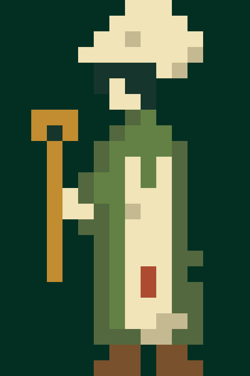

# Cook sprite — flat 16×24 style

Status: created, imported and reviewed, 2026-10-18.

User request: create a cook sprite using the new native Seed Keeper design.
Reference: `ArtSource/SeedKeeper3/seed-keeper-3.png`; no Qud assets or code copied.

## Design and verification sweep

- Existing `SpreadWaysideCook` description specifies a flour-pale cap and patched
  apron. Those are the main profession cues, with a long wooden cooking spoon.
- Use the same 16×24 canvas, hard edges, spare silhouette and olive colors as
  Seed Keeper 3. Keep the cream cap/apron and rust repair patch readable at native size.
- Built-in imagegen supplied a concept using the keeper as a reference. Its glow
  and finer detail were unsuitable for the native style. Final cells were authored
  directly on a 16×24 grid, then exported in Unity with no automatic downsampling.
- This is an asset addition. Existing game NPC routing and the Seed Keeper-only
  study are unchanged; no runtime script or gameplay test is needed for this import.

## Results

Native PNG: 16×24 RGBA, 156 opaque and 228 transparent pixels, eight opaque colors,
alpha values only 0 and 255. Every grid/JSON cell matches the PNG. Source and Unity
PNGs are byte-identical; the Piskel embeds that exact PNG. The 512×768 preview is
an exact 32× nearest-neighbor enlargement on `#032F23`.

Unity: Sprite Single, Point, Uncompressed, no mipmaps/NPOT resizing, full rectangle,
16 PPU, bottom-center pivot. Reusable prefab uses the existing unlit material,
white tint and no shadows. The original study scene remains clean.

## Self-review and limits

- 🔵 Final authoring deliberately simplifies the generated concept to real native
  pixels; the concept remains outside Assets as provenance, not production art.
- 🧪 Independent art review confirmed cap, apron, boots and spoon readability,
  connected utensil/hand and feet/body, and no stray opaque pixels.
- 🧪 Can verify: every exported pixel, eight colors, binary alpha, exact preview,
  Piskel/source/import identity and Unity prefab references. Native preview viewed.
- 🧪 Cannot claim: animation, replacing every existing cook or live gameplay tests
  with this sprite. This request creates the sprite; no gameplay code was changed.

[Source and edit instructions](../ArtSource/Cook16x24/README.md) ·
[Final prompt](../ArtSource/Cook16x24/imagegen-prompt.txt) ·
[Verification](../ArtSource/Cook16x24/verification.json).

Files: native PNG and import metadata, reusable prefab, editable Piskel/SVG/grid,
palette/pixel exports, generated concept and prompt, verification records and docs.

## Flat study placement

Subsequently placed the reusable cook prefab in the cell immediately right of
the keeper in `Assets/Scenes/Studies/SeedKeeper16x24.unity`, at the user's request.
Both share the same baseline and native pixel scale. Actual Unity Play rendering
and the exact source composite were verified; see the [study record](PIXEL-16X24-STUDY.md#cook-placed-alongside-the-keeper).
This scene is still a static art study, without gameplay NPC simulation.
