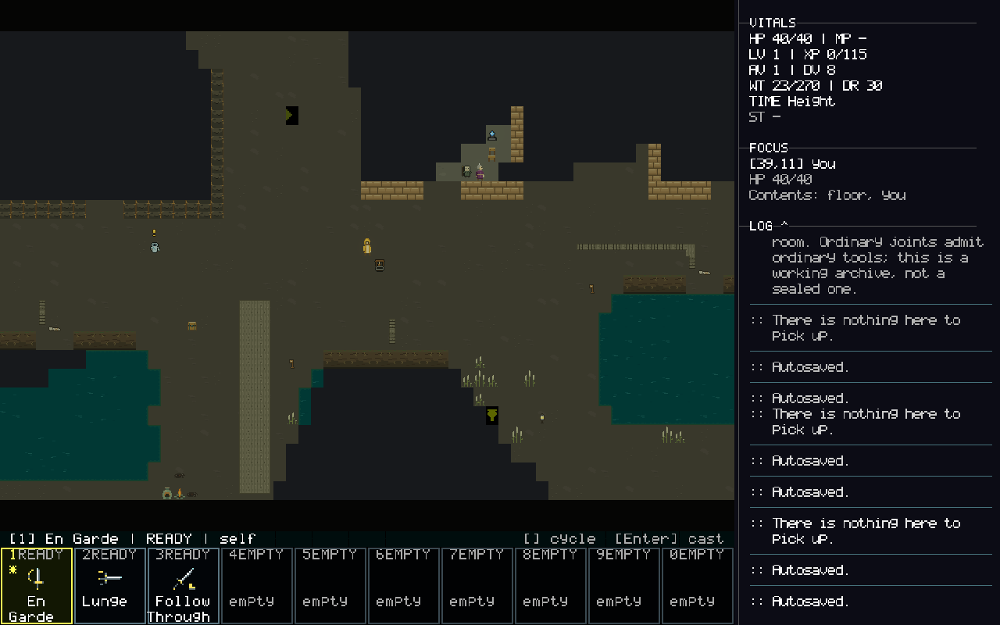
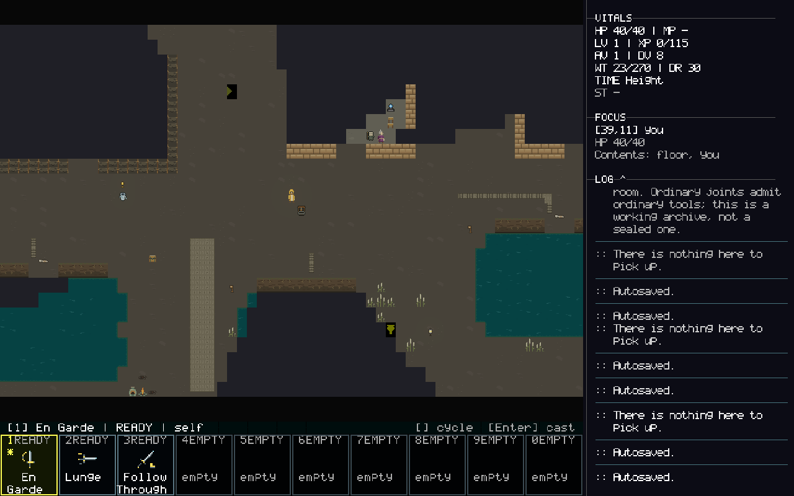

# Drowned Ledger native palette

Status: bounded Editor acceptance; no whole-area polish claim. Original CoO presentation; no Qud-parity claim.

The broad Sodden green filter made approved dirt, stone and wood too similar in the actual center, reading room and west waterfront. Exact current native Drowned Ledger17.5 now uses a neutral white filter, keeps contrast6 and reduces saturation4→0. Water stays dark teal and floors subdued. No new art or imagegen was needed; approved sources remain unchanged.

## Scope and source corrections

The site is canonical Sodden, Village/ExcavationCamp. Its same-biome neighbor is18.5; depth17.5.1 uses cave grading. Admission also requires current world/cache authority, displayed native renderer, exact address/name and no saved lair. Separate invalidation flag restores ordinary grading on travel, legacy mode or authority loss. Unsupported aliases and foreign saved biomes decline.

## Verification

15 native RED failures on the initial positive grade premise precede the production edit. Final364/364 native tests pass: grade/countercases, travel, existing water and composition/adversarial suites. Independent test/source and four-pair visual reviews report0 P1/P2.

Actual GameBootstrap starts at earned5110HP40, seed224401440,39,11. Center, readingroom18,6, full reading-only StoneFloor reader and west14,14 are matched. Ordinary routes pass the real entrance; NPC movement is excluded from palette attribution. World17.5↔18.5 restores the original neighbor grade and reapplies the local grade. F5 and a fresh isolated Continue retain5850HP40 at39,11,F12off. No healing,combat,destruction,transfer or rest occurred.

All2470 terrain records and TileState match before/after. Ordinary turns change305water temperatures,1fire temperature,1light intensity and14cooccupancy records; IDs/positions/TileState remain exact. Freshreload changes only1light intensity in the terrain record. Reloadworld122pixels differ by at most1RGB; cause unproven. All four paired sidebar/hotbar regions are exact; reloadsidebar log differs.

The75.581s after-only1280×800 OSXEditor/AppleM5 profile has47233unwrapped samples: rendererp95.091791ms,max81.858875ms,Mainmax765.793792ms. Includes native tools and Editor scheduling; no speedup/FPS acceptance;R11 stays open.

## Self-review and remaining work

No remaining P1/P2 within this slice. Scope divergence:none; palette-only, no content or mechanics change. 83foreign changes,1owned neutral importer delta,normal saves/gameplay preferences and required builds preserved;4Unitysession bookkeeping keys disclosed. Editor stopped,rootnull,clean. Initial reload launch raced the Finish menu and remained stopped with no save copy; the later fresh launch is the accepted run.

Sparse ground, tiny props, black glyph backings, dark remembered terrain, shadows, population and full-area acceptance remain separate. Current843fb514f packages exclude this palette; batch after the next accepted graphics slice. Linux execution unverified; Deck deferred.

Evidence: [receipt](Verification/GraphicsExecution/DrownedLedgerGrade/receipt.json), [native](Verification/GraphicsExecution/DrownedLedgerGrade/native-receipt.json), [source review](Verification/GraphicsExecution/DrownedLedgerGrade/source-review.md), [visual review](Verification/GraphicsExecution/DrownedLedgerGrade/visual-review.md).

Before:

After:

Next: Fresh Cinderhold workshop baseline from CinderholdGrade/AfterCheckpoint2110HP40 at38,11,seed704860946. Verify ordinary Right18 to56,11 thenUp3 to56,8 entrance; capture frontage/interior and existing TinkersForge,SmithAnvil,Weaponsmith before proposing a coherent change. Preserve receiving ground, reserved service approaches, stock and cached layouts. Peat Works two-empty-crate suggestion parked as low visual value. Batch DrownedLedger plus next accepted graphics; current843 packages exclude this palette.
