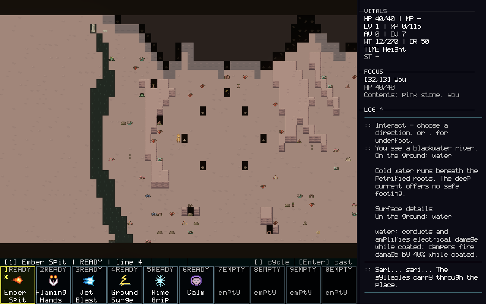
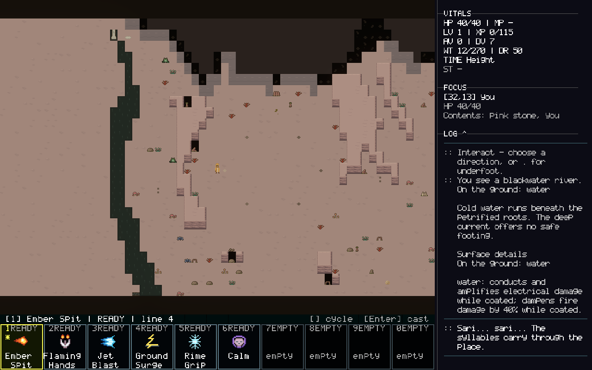

# Felling circle ground continuity

The six bare positions and the seventh position stood on black rectangles that
interrupted the accepted pink stone. This comparison draws only their existing
authored TepuiStone, using unchanged Stump frames0–3. It retains the actual ritual
glyphs, readers, exact positions and gameplay parts; no terrain is created.

Exact coordinate roles, owner tags/render fields and unique owned SeventhPositionPart
are required. Duplicate disclosed markers, changed meaning, coatings, stale authority,
fog and missing resources refuse. Removing a marker leaves its real floor without
recreating the ritual. Native initial21 shared-positive-premise RED failures became
248/248 focused passes, including broader Felling/Stump/ritual behavior checks.
An earlier zero-test discovery run is retained and excluded. Independent source
and visual reviews found no P1/P2. Six darker cross marks remain distinct from floor
flecks; the separate yellow seventh remains identifiable, though subtle.

Actual GameBootstrap comparison reuses earned seed704860946, turn1320HP40at20,13.
Bank, circle32,13 and seventh40,9 views and both full field-note readers are retained.
The seventh applied Confused2 on stepping onto40,8, fell to1 on leaving and expired
on the next normal action. EndingSpine remained0. Normal3.5→5.5→3.5 travel passed;
a held Right repeated twice, so this is not a single-neighbor travel claim.
F5/fresh Continue1830HP40at40,12 preserves14floor/marker records and TileStates.
Reload world/hotbar are pixel-identical; sidebar logs differ. Bank changes outside the seven cells are627pixels atmax1RGB. Circle/seventh show
actor-position changes plus small RGB variance; they are not wholly marker-only comparisons.

The97.407s after-only Editor profile includes initialfixture→Continue and tool/UI
scheduling: renderermax216.446ms, Mainmax2266.133ms, GCmax742540817bytes.
No performance improvement or R11 closure.83foreign files, normal saves and gameplay
preferences remain intact; four runtime/test metadata preference keys changed.
No art, storage cleanup, shadow, population, geometry or ending changes.

Publication/currentdelivery pending. CurrentMac/Linux sourcea33b46cab excludes
Quillhold roads and this comparison. Linux remains unexecuted;Deck deferred.
Next after acceptance: batchcurrentMac/Linux and actualMac, then fresh Lampwell12.3.2
hearth-circle baseline from LampwellRocks/AfterCheckpoint6080HP39at40,12.
Coverage, area polish, population, shadows and delivery remain separate;V0–V7 incomplete.
