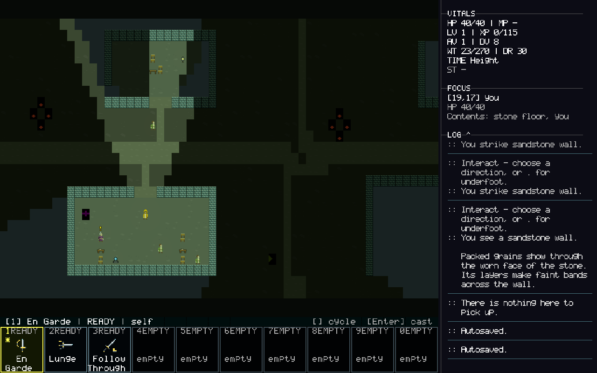

# Quillhold Copy Hall composition

Three ordinary chairs complete the two existing writing bays in newly generated Quillhold. Existing desks, the Innkeeper-owned chair, Scribe frontage, shrine, shelves, stock, doorway and center aisle remain in place. The late builder respects the realized plan and refuses the entire group if any candidate is unsafe. Cached rooms are unchanged.

Native RED covered the absent composition and seven malformed payload cases; final **183/183 passed**. Actual fresh town from proven uncached seed224401440, matched center/hall, full readers, Scribe Sitting, neighbor travel, F5 and fresh Continue4980HP40 all passed. Older cached4180 save retains only its original hall chair. The three new seats were reserved by NPCs; successful player Sit/Stand was not observed. Independent source and visual reviews have no remaining P1/P2.

The 46.209s unwrapped Editor profile is after-only; renderer p95 0.104ms/max463.438ms, Main p95 2.204ms/max2208.303ms. Generation and capture are included; spikes remain unattributed. Reload has286 player-area worldpixels differing, cause unknown; chair state exact. Whole-area polish, R11 and V0–V7 remain open.

[Detailed receipt](Verification/GraphicsExecution/QuillholdCopyHall/receipt.json), [native final](Verification/GraphicsExecution/QuillholdCopyHall/native-final.xml), [independent review](Verification/GraphicsExecution/QuillholdCopyHall/independent-review.md). Current c53 Mac/Linux builds exclude this composition; batch after the next accepted graphics slice. Deck work remains deferred. Next: fresh Spivenor hearth-circle backing comparison.
