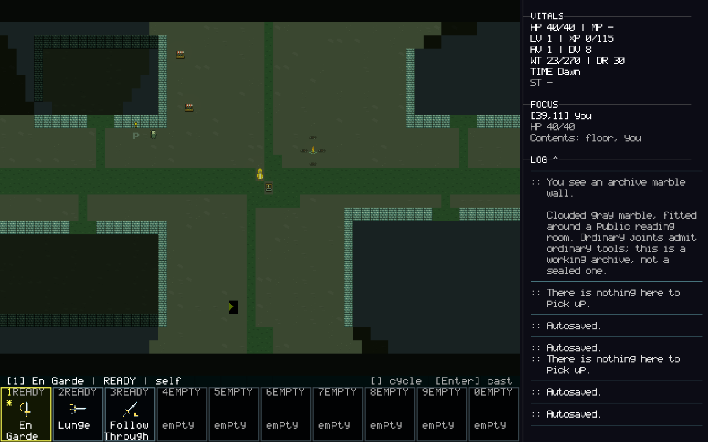
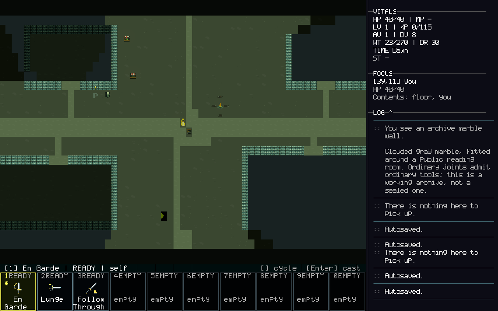

# Quillhold court and road separation

Quillhold’s packed roads used green speckled ground that read as vegetation.
This slice reuses the approved quieter worn-road frames32/33 only for the
current authored14.9.0 Spread Village/PrimaryArchive. Plain courts and stone
interiors retain their existing materials; no art, layout, population, shadow,
marble or gameplay change.

The [receipt](Verification/GraphicsExecution/QuillholdRoad/receipt.json) retains
12 expected positive-premise RED failures and2 unchanged-material controls,
then146/146 native passes. Source and three-view/reload visual reviews found
no P1/P2. Actual GameBootstrap reads packed road, floor and stone floor;
ordinary center-to-CopyHall movement and14.9↔13.9 travel passed. F5/fresh
Continue5310HP40at39,11 retains2000ground IDs/types/positions. Reload world and
hotbar are identical; sidebar logs shift. Approach97pixels1RGB and interior
128red-markerpixelsmax4RGB outside the original road colors remain unexplained.

The158.036second after-only Editor profile includes UI/tool scheduling:
renderermax154.409ms, MainThreadmax2077.073ms, GCmax814889933bytes.
No performance improvement or R11 closure is claimed.83foreign edits and
normal saves/gameplaypreferences remain intact; four runtime/test preference
metadata keys changed. No storage cleanup. Whole-area grading/composition,
coverage, population, shadows and delivery remain separately tracked.

Publication and next batched delivery pending at this record. Current accepted
Mac/Linux sourcea33b46cab excludes these roads; Linux execution untested and
Deck-specific work deferred. Next: fresh Felling central-circle ground baseline
from earned FellingBlackwater/after-save1320HP40at20,13seed704860946; preserve
its accepted water and all ritual mechanics.
