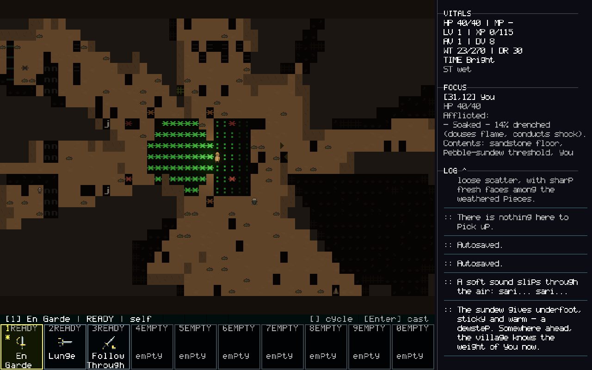
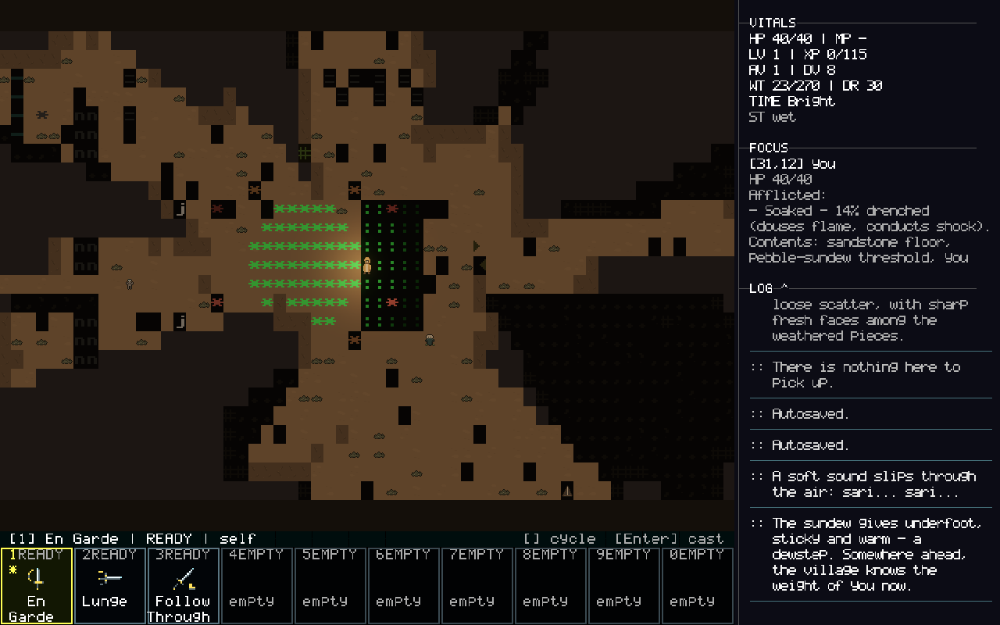

# Spivenor hearth backing

The inhabited hearth circle now sits on its existing sandstone instead of black rectangles. Approved sandstone frames12–15 appear only under40 real SandstoneFloor owners;6Rubble and1floorless hearth cells use a separate flat ambient base. Existing green fungus glyphs, light, collision, readers, sundew threshold and political damage behavior remain intact. Only current Spivenor16.4.2 qualifies; memory and other-depth policy are unchanged.

Native RED38 shared-premise failures plus3controls precede **433distinctpasses**. The initial433 run passed431; two old material expectations explicitly required rejected hearth backing. Their exact depth2 expectations were corrected, all94material cases passed, and339other passes were reused. Repeated tests are not additive. Independent source and actual visual reviews have0P1/P2.

Actual GameBootstrap center/east/north comparisons, full hearth reader, sundew walking,2↔1stairs,F5/freshContinue6310HP40 passed withF12off. All47fullhearth/substrate records,TileState andCatacombFolkrep0 are exact at matchededge and reload. Earlier fixture acquisition used protection during path surveying and three wall strikes and cannot establish natural acquisition; this comparison used no protection, injection, healing, combat or Break action.

The76.790s unwrapped Editor profile has44296samples, rendererp95.114ms/max84.713ms andMainp952.388ms/max2070.926ms. It is after-only and does not closeR11. Reload18468worldpixels darken by≤6RGB, causeunproven; records exact. Dense repeated fungus, neighboring specialbackings, memoryglyphs and whole-area polish remain open.

[Receipt](Verification/GraphicsExecution/SpivenorHearth/receipt.json),[source review](Verification/GraphicsExecution/SpivenorHearth/source-review.md),[visual review](Verification/GraphicsExecution/SpivenorHearth/visual-review.md).83foreignchanges/normalstate/gameplayprefs preserved,4sessionmetadataexceptions. Currentc53packages exclude this slice and CopyHall. Batch both next; Deck deferred; then fresh Gantry road/grass comparison.
