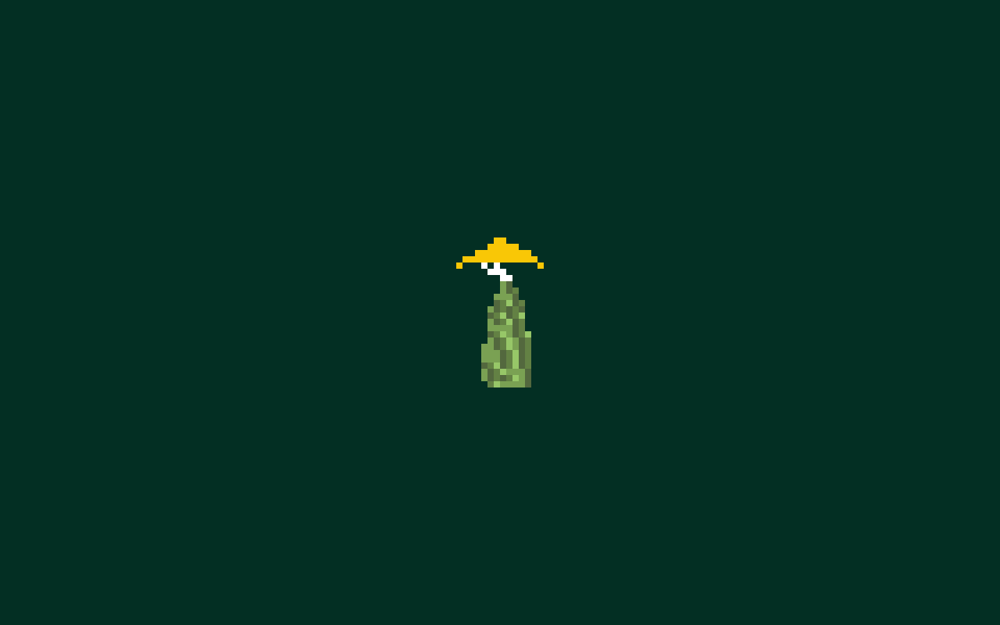

# Flat 16×24 presentation study

Status: completed and verified in Unity Play mode, 2026-10-18.

## User scope

Start with a blank dark-green field and Seed Keeper 3 as the only visible object.
Use a flat top-down pixel grid in the spirit of Qud. This first visual study is
a separate scene; expanding the actual spawn chunk is a later step. The source
art is the user's own 16×24 PNG and editable Piskel, not a Qud asset.

## Preserved style and restoration

The complete current native 3D game and its tracked assets are preserved at
Git tag `graphics-3d-preserved-2026-10-18` (commit `427f91b55`). No old art is
deleted. Reopen `Assets/Scenes/Main/SampleScene.unity` to return to the existing
game; the study uses its own scene, camera and sprite material. The detailed
Blender keeper can also be rebuilt using `Docs/SEED-KEEPER-FLAT-ART.md`; the
earlier corrected native sprite remains in `ArtSource/SeedKeeper16x24`.

For a separate reference checkout, without resetting the current project:

```sh
git worktree add ../caves-of-ooo-3d-reference graphics-3d-preserved-2026-10-18
```

That command creates another checkout and may require Unity to regenerate its
local cache. Reopening the preserved scene in this checkout is the quick switch.

## Verification sweep and plan

| Check | Finding and decision |
| --- | --- |
| Current cell size | Actor frames default to 16×24, but environment tiles are 16×16 (`EnvironmentSpriteRenderer.cs`). Disabling 3D alone does not produce the requested consistent rectangular grid. |
| Rectangular proportions | Use a Grid with cell size 1×1.5 and the native 16-PPU sprite; preserve square artwork pixels. |
| Lighting | Use the installed URP sprite-unlit shader and orthographic camera, with no perspective, fog or painted ground detail. |
| Sharpness | Use installed URP PixelPerfectCamera with Point filtering and an integer upscale target. |
| Starting Play | DefaultSceneLoader recognizes only SampleScene and ReferenceGlade. Add an exact allowlist entry for this scene so Play shows the study. Retain the fallback for other scenes. |
| World state | The study has no bootstrap, saves or NPC simulation. Existing scenes, world content, rendering settings and player preferences are preserved. |

1. Save the sprite material/prefab and minimal scene, containing only camera,
   an unlit-compatible light, empty rectangular Grid and Seed Keeper sprite.
2. Add a failing Play-start regression for the new scene, then support the exact
   scene and add menus to open the study or return to the 3D spawn.
3. Test the scene selection alongside existing scene regressions. Enter Play,
   inspect the actual Game view and capture it. Review asset isolation and source
   fidelity, then commit and publish the preservation tag with main.

## Using the study and returning to the existing world

In Unity, use **Caves Of Ooo → Scenes → Open 16x24 Seed Keeper Study** and press
Play. Exit Play and choose **Return to 3D Spawn** to reopen the existing game.
Both menu routes were exercised; the original scene remains clean. The study
is left open in the editor after verification. It is intentionally a static
visual study with one sprite, with no movement, dialogue or HUD.

## Results and self-review

- Scene: `Assets/Scenes/Studies/SeedKeeper16x24.unity`. Empty field is camera
  clear color `#032F23`. One SpriteRenderer uses the original transparent PNG,
  16 PPU, uniform scale, white tint, unlit shader and no shadows. The empty Grid
  stores 1×1.5 cell dimensions; no visible grid lines or decoration are added.
- Camera: orthographic, zero tilt, 160×100 reference resolution, Point upscale,
  no post-processing or anti-aliasing. At 1280×800 each source pixel is exactly
  8×8 screen pixels. The occupied sprite is 112×192 (14×24 occupied pixels).
- RED: the new scene-selection case failed because Play redirected to the main
  game; the other four scene cases passed. [Receipt](Verification/SeedKeeper16x24/study-red.json).
- GREEN: all five actual Unity EditMode scene cases completed successfully, with
  no failures; [receipt](Verification/SeedKeeper16x24/study-green.json). This is
  in addition to the preceding 146 keeper/model/portrait regression cases.
- Native Play: one sprite, zero MeshRenderers and zero GameBootstraps. The actual
  Game frame contains only seven colors: six exact source colors and the flat
  background. Every screen pixel matches the expected 8× nearest-neighbor source
  composite with **zero RGBA difference**, including all transparent regions.
  [Capture proof](Verification/SeedKeeper16x24/study-capture.json),
  [live observer](Verification/SeedKeeper16x24/study-live.json).
- 🟡 Fixed: DefaultSceneLoader previously entered the real game when the study
  was selected. An exact scene allowlist entry fixes this; SampleScene and
  ReferenceGlade regression cases still pass.
- 🔵 Scope: user narrowed the spawn conversion to this first blank-field study.
  No world content, renderer preferences or main-scene assets were replaced.
  A later actual-spawn conversion needs camera/picking/cursor/effect alignment
  and a coherent tile set; it is not claimed by this visual study.
- 🧪 Can verify: actual Play scene, exact source colors and pixel scale, one
  visible character, clear background, saved prefab/material isolation, both
  scene menu routes and original LastGame/save-root values. Original scene and
  all native 3D/source-resource trees have no changes from the preservation tag.
- 🧪 Cannot verify: physical Steam Deck behavior or gameplay in this static scene.
  No player build was made. Metal emitted two memoryless depth load/store
  warnings during screen capture; the frame is exact and no script errors were
  observed. One temporary MCP disconnect during test-result retrieval recovered;
  the completed five-case job reported success.



Files: minimal study scene and metadata; reusable flat prefab/material under
`Assets/Art/SeedKeeper3`; DefaultSceneLoader allowlist and two menus; one additional
scene-selection test case; this living document and verification receipts.
No new runtime component or per-frame script was introduced.
