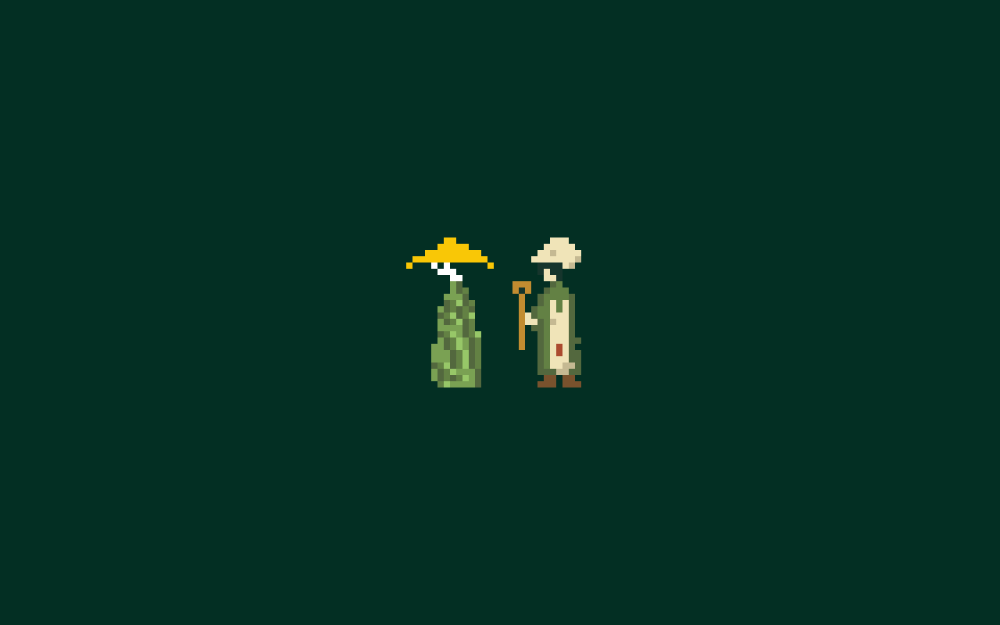
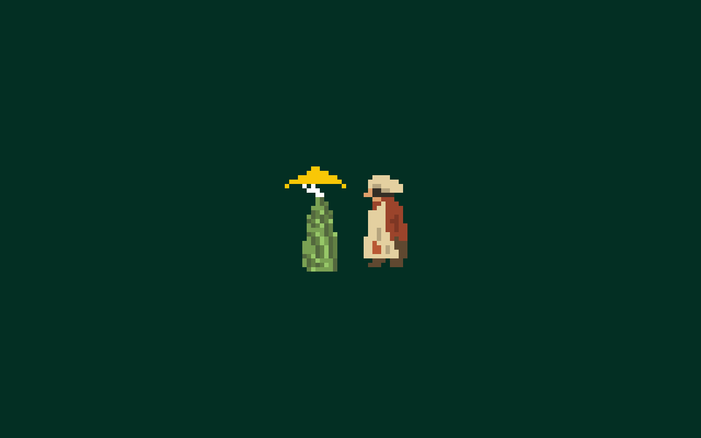
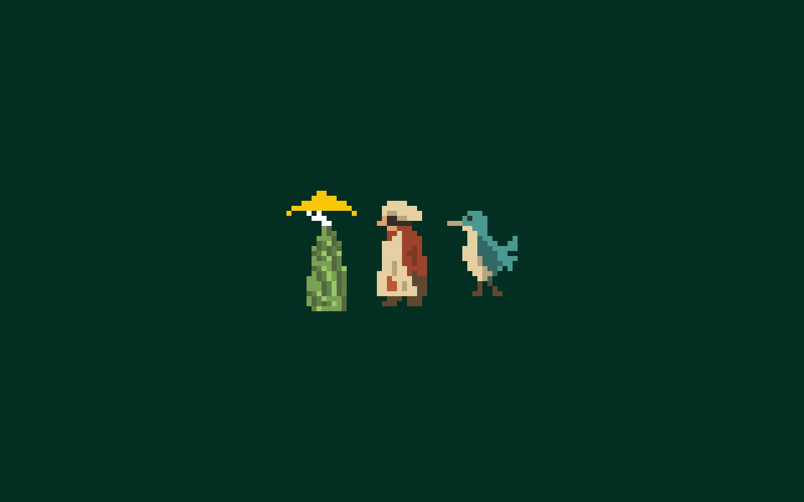
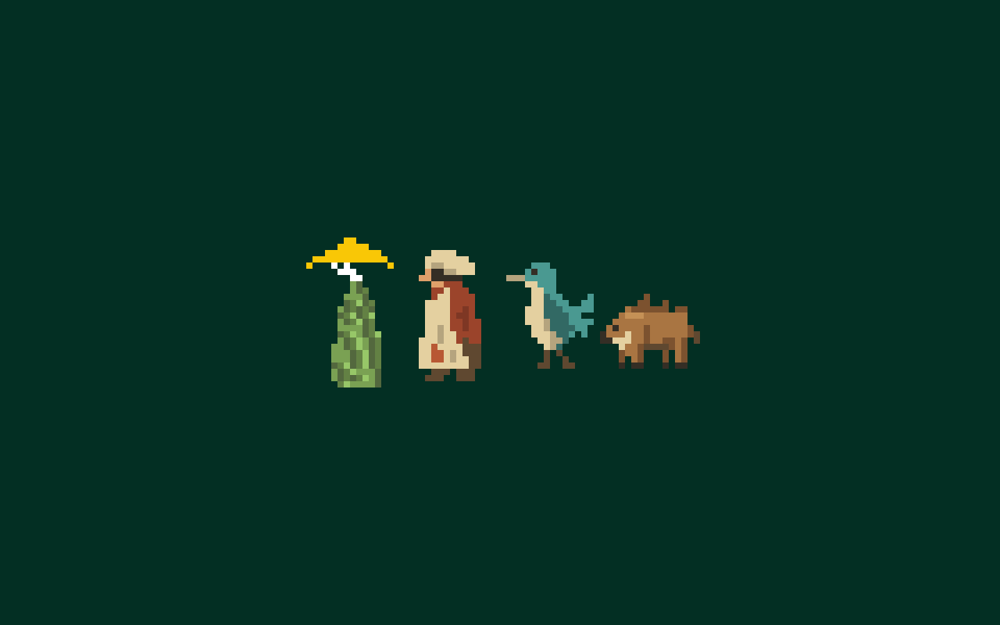
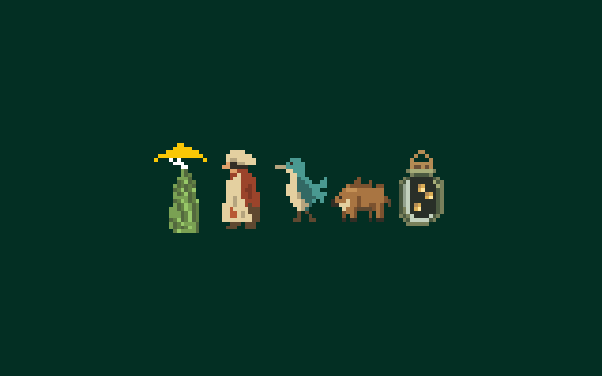

# Flat 16×24 presentation study

Status: completed and verified in Unity Play mode; latest addition 2026-10-21.

## User scope

Initial scope: a blank dark-green field and Seed Keeper 3 alone. The user then
requested the cook, Tatterjay, Reedback Grazer and beetle jar; the current saved
study contains all five sprites.
Use a flat top-down pixel grid in the spirit of Qud. This first visual study is
a separate scene; expanding the actual spawn chunk is a later step. The source
art is the user's own 16×24 PNG and editable Piskel, not a Qud asset.

## Preserved style and restoration

The complete current native 3D game and its tracked assets are preserved at
Git tag `graphics-3d-preserved-2026-10-18` (commit `427f91b55`). No old art is
deleted. Reopen `Assets/Scenes/Main/SampleScene.unity` to return to the existing
game; the study uses its own scene, camera and sprite material. The detailed
Blender keeper can also be rebuilt using `Docs/SEED-KEEPER-FLAT-ART.md`; the
earlier corrected native sprite remains in `ArtSource/SeedKeeper16x24`.

For a separate reference checkout, without resetting the current project:

```sh
git worktree add ../caves-of-ooo-3d-reference graphics-3d-preserved-2026-10-18
```

That command creates another checkout and may require Unity to regenerate its
local cache. Reopening the preserved scene in this checkout is the quick switch.

## Verification sweep and plan

| Check | Finding and decision |
| --- | --- |
| Current cell size | Actor frames default to 16×24, but environment tiles are 16×16 (`EnvironmentSpriteRenderer.cs`). Disabling 3D alone does not produce the requested consistent rectangular grid. |
| Rectangular proportions | Use a Grid with cell size 1×1.5 and the native 16-PPU sprite; preserve square artwork pixels. |
| Lighting | Use the installed URP sprite-unlit shader and orthographic camera, with no perspective, fog or painted ground detail. |
| Sharpness | Use installed URP PixelPerfectCamera with Point filtering and an integer upscale target. |
| Starting Play | DefaultSceneLoader recognizes only SampleScene and ReferenceGlade. Add an exact allowlist entry for this scene so Play shows the study. Retain the fallback for other scenes. |
| World state | The study has no bootstrap, saves or NPC simulation. Existing scenes, world content, rendering settings and player preferences are preserved. |

1. Save the sprite material/prefab and minimal scene, containing only camera,
   an unlit-compatible light, empty rectangular Grid and Seed Keeper sprite.
2. Add a failing Play-start regression for the new scene, then support the exact
   scene and add menus to open the study or return to the 3D spawn.
3. Test the scene selection alongside existing scene regressions. Enter Play,
   inspect the actual Game view and capture it. Review asset isolation and source
   fidelity, then commit and publish the preservation tag with main.

## Using the study and returning to the existing world

In Unity, use **Caves Of Ooo → Scenes → Open 16x24 Seed Keeper Study** and press
Play. Exit Play and choose **Return to 3D Spawn** to reopen the existing game.
Both menu routes were exercised; the original scene remains clean. The study
is left open in the editor after verification. It is intentionally a static
visual study with five sprites, with no movement, dialogue or HUD.

## Initial single-character results and self-review

- Scene: `Assets/Scenes/Studies/SeedKeeper16x24.unity`. Empty field is camera
  clear color `#032F23`. One SpriteRenderer uses the original transparent PNG,
  16 PPU, uniform scale, white tint, unlit shader and no shadows. The empty Grid
  stores 1×1.5 cell dimensions; no visible grid lines or decoration are added.
- Camera: orthographic, zero tilt, 160×100 reference resolution, Point upscale,
  no post-processing or anti-aliasing. At 1280×800 each source pixel is exactly
  8×8 screen pixels. The occupied sprite is 112×192 (14×24 occupied pixels).
- RED: the new scene-selection case failed because Play redirected to the main
  game; the other four scene cases passed. [Receipt](Verification/SeedKeeper16x24/study-red.json).
- GREEN: all five actual Unity EditMode scene cases completed successfully, with
  no failures; [receipt](Verification/SeedKeeper16x24/study-green.json). This is
  in addition to the preceding 146 keeper/model/portrait regression cases.
- Native Play: one sprite, zero MeshRenderers and zero GameBootstraps. The actual
  Game frame contains only seven colors: six exact source colors and the flat
  background. Every screen pixel matches the expected 8× nearest-neighbor source
  composite with **zero RGBA difference**, including all transparent regions.
  [Capture proof](Verification/SeedKeeper16x24/study-capture.json),
  [live observer](Verification/SeedKeeper16x24/study-live.json).
- 🟡 Fixed: DefaultSceneLoader previously entered the real game when the study
  was selected. An exact scene allowlist entry fixes this; SampleScene and
  ReferenceGlade regression cases still pass.
- 🔵 Scope: user narrowed the spawn conversion to this first blank-field study.
  No world content, renderer preferences or main-scene assets were replaced.
  A later actual-spawn conversion needs camera/picking/cursor/effect alignment
  and a coherent tile set; it is not claimed by this visual study.
- 🧪 Can verify: actual Play scene, exact source colors and pixel scale, one
  visible character, clear background, saved prefab/material isolation, both
  scene menu routes and original LastGame/save-root values. Original scene and
  all native 3D/source-resource trees have no changes from the preservation tag.
- 🧪 Cannot verify: physical Steam Deck behavior or gameplay in this static scene.
  No player build was made. Metal emitted two memoryless depth load/store
  warnings during screen capture; the frame is exact and no script errors were
  observed. One temporary MCP disconnect during test-result retrieval recovered;
  the completed five-case job reported success.


Files: minimal study scene and metadata; reusable flat prefab/material under
`Assets/Art/SeedKeeper3`; DefaultSceneLoader allowlist and two menus; one additional
scene-selection test case; this living document and verification receipts.
No new runtime component or per-frame script was introduced.


## Cook placed alongside the keeper

The user requested the cook next to the keeper and an actual scene screenshot.
The saved study now instantiates `Assets/Art/Cook16x24/Cook16x24.prefab` in the
adjacent rectangular cell. The pair is centered: keeper at (-0.5, -0.75), cook at
(0.5, -0.75), both at scale 1 with the same baseline and unlit material. The Grid
origin shifts from (-0.5, -0.75) to (-1, -0.75) to center the two adjacent cells.
No sprite or camera sizing changes.

Verified in actual Unity Play mode: two sprites, zero gameplay bootstraps, flat
camera and 1×1.5 cell geometry. The unedited 1280×800 Game capture matches the
complete expected source composite at 8× scale with **zero differing pixels**.
The proof covers every background and transparent cell as well as both figures.
Play stopped; Game view index restored to 0; saved study is clean with two actors.
This is a scene-placement change; no runtime code or new gameplay tests.

[Live observer](Verification/SeedKeeper16x24/keeper-and-cook-live.json) ·
[Exact pixel verification](Verification/SeedKeeper16x24/keeper-and-cook-capture.json).



Self-review: no notable outstanding issues. Can verify saved prefab placement,
scale, native colors/pixels, actual Game rendering and editor restoration. Cannot
claim movement, conversation or live NPC simulation in this static art study.
The preserved 3D world and assets remain available through the existing menu.


## Current cook artwork — Downloads selection

The user then selected the Downloads cook PNG. The existing cook sprite asset
was replaced byte-for-byte while preserving its GUID, prefab and scene placement.
The selected PNG/Piskel are preserved in `ArtSource/CookDownloads`; the earlier
cook source remains as an alternative. See the [current cook record](COOK-16X24-ART.md#user-selected-downloads-replacement).

Actual Unity Play capture matches both selected PNGs at exact 8× scale with zero
differing pixels. This is an art-only replacement; scene/prefab files and runtime
code did not change. Play stopped and original Game view index restored; study clean.




## Tatterjay added

Added the user's Downloads `tatterjay.png` with its matching latest Piskel,
retaining their bytes under `ArtSource/Tatterjay16x24`. The PNG is native 16×24,
103 opaque pixels and six opaque colors, with binary alpha. Its Piskel frame
matches exactly. The older `tatterjay-matched` export differs; the latest explicitly
named PNG is authoritative. No art generation, resampling or recoloring.

Imported with the same Point, uncompressed, 16-PPU, bottom-center settings and
unlit material as the other figures. Added a reusable Tatterjay prefab in the
next adjacent cell. Grid origin moves to (-1.5, -0.75) to center three cells;
keeper/cook/bird world X positions are -1/0/1, all sharing Y -0.75 and scale 1.

Actual Unity Play: three sprites, zero game bootstraps. The unedited 1280×800 Game
frame matches every pixel of the three source images composited over `#032F23`
at exact 8× scale, with zero differing pixels. Source/Unity PNG byte identity
and native import settings verified. Play stopped, Game view index restored to
0, saved study clean. No runtime code changed; asset/scene verification is the
appropriate check for this static addition.

[Source and edit instructions](../ArtSource/Tatterjay16x24/README.md) ·
[Live observer](Verification/SeedKeeper16x24/tatterjay-live.json) ·
[Exact pixel proof](Verification/SeedKeeper16x24/tatterjay-capture.json).



Self-review: no notable outstanding findings. Can verify source fidelity, prefab
placement, exact actual Game rendering and editor restoration. Cannot claim
animation or gameplay Tatterjay behavior in this static art study.


## Reedback Grazer — 03-ridge added

Added the user-selected `Downloads/grazer-editable-source/03-ridge.png`, with its
unchanged editable grid, SVG and palette in `ArtSource/ReedbackGrazer16x24`.
All 384 PNG cells match the grid/SVG. Native canvas is 16×24 with 111 opaque
pixels and six colors. The low 16×12 occupied silhouette keeps its original
transparent margins, without stretching or trimming.

Same native sprite import settings and unlit material as the existing figures.
The reusable grazer prefab occupies the fourth adjacent cell. Grid origin moves
to (-2, -0.75), centering actors at world X -1.5/-0.5/0.5/1.5, shared Y -0.75,
all at scale 1. No camera or earlier sprite changes.

Actual Unity Play capture contains four sprites and no gameplay bootstrap. Every
pixel of the unedited 1280×800 frame matches the four PNGs composited at exact 8×
scale, with zero differing pixels. Source/Unity PNG byte identity and import
settings verified. Play stopped, Game view index restored to 0, saved study clean.
This is an asset/scene-only addition; no runtime code or new gameplay tests.

[Source and edit instructions](../ArtSource/ReedbackGrazer16x24/README.md) ·
[Live observer](Verification/SeedKeeper16x24/grazer-live.json) ·
[Exact pixel proof](Verification/SeedKeeper16x24/grazer-capture.json).



Self-review: no notable outstanding findings. Can verify source fidelity,
placement and exact Game rendering. Cannot claim animation or grazer gameplay
behavior from this static art study.


## Beetle jar added — 2026-10-21

Imported the supplied 16×24 `beetle-jar.png` and matching Piskel unchanged. The
new study sprite/prefab uses the existing native scale and unlit material. Grid
origin moves to (-2.5, -0.75), centering five adjacent cells. Earlier artwork and
camera remain unchanged. The existing game's `BeetleJar` 2D resource also receives
the exact source PNG, retaining its metadata/GUID; the original 3D model is preserved.

Actual Unity Play: five sprites, no gameplay bootstrap. The complete 1280×800
frame matches the source PNG composite at exact 8× scale with zero differing
pixels. Play stopped, original Game view index 0 restored and saved scene clean.
Existing targeted jar-resource/3D checks pass 21/21. A broader terrain census
failure for two unrelated fixtures also occurs with the original jar PNG; it is
recorded in the [jar living document](BEETLE-JAR-16X24-ART.md), not claimed green.

[Source/edit instructions](../ArtSource/BeetleJar16x24/README.md) ·
[Exact Game-frame proof](Verification/SeedKeeper16x24/beetle-jar-capture.json).



Can verify exact source/native rendering, placement, resource connection and
restoration. Cannot claim new jar gameplay or a replacement 3D portrait from this
static study. No runtime script or gameplay blueprint changed.
