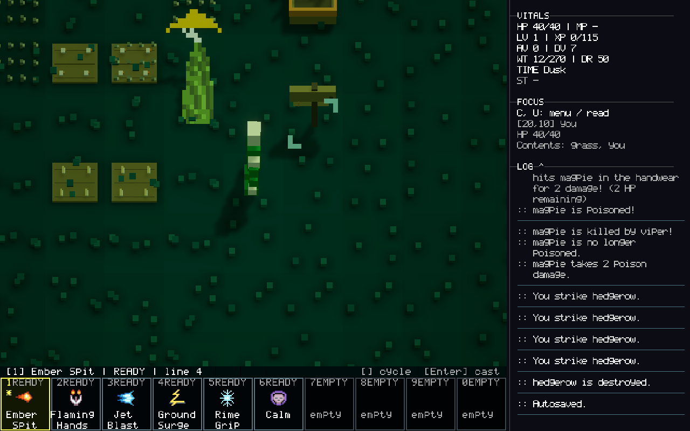

# Seed Keeper — supplied 16×24 sprite

Status: native 16×24 gameplay replacement completed and verified in Unity
(2026-10-18). The user subsequently selected Seed Keeper 3 from Downloads.
The earlier corrected design remains available as an editable alternative.

The user supplied `seed-keeper-16x24-source.zip` after requesting a recreation of
the simplified Seed Keeper. The archive already contains that artwork. Its
native PNG, previews, SVG, literal grid, palette metadata and generator are
preserved unchanged in Git commit `121c780f2`. The working files under
`ArtSource/SeedKeeper16x24/` now contain the requested reference corrections.
`reference-higher-resolution.jpg` preserves the newer user-supplied comparison.

## Import

`Assets/Art/SeedKeeper16x24/seed-keeper-16x24.png` is a byte-identical copy of the
current source PNG. Unity imports it as a single sprite with point filtering,
uncompressed texture data, no mipmaps, no non-power-of-two resizing, clamp wrap,
full-rect mesh and 16 pixels per unit. Its pivot is `(8, 1)` native pixels, at the
bottom of the boots above the transparent bottom margin.

This earlier corrected sprite remains available in the Project browser. The live
Seed Keeper now uses the later user-selected Seed Keeper 3, described below.
The original detailed Blender source is retained in `SEED-KEEPER-FLAT-ART.md`.

## Original import verification

- Compared every grid cell against the supplied photographic reference: same
  silhouette and color regions. Source colors differ from JPEG interiors by at
  most one value per RGB channel; the lossless source palette is authoritative.
- Native PNG: 16×24 RGBA, eight opaque colors, 151 opaque and 233 transparent
  pixels, alpha values only 0 and 255. Grid and metadata match every pixel.
- Preview PNGs: exact 8× and 32× nearest-neighbor enlargements on opaque teal.
  Visually inspected the supplied 32× preview. The native PNG supplies transparency.
- Initial Unity import used bilinear filtering; inspection caught this before
  completion. Reimport confirmed Point, Uncompressed, no mipmaps, full rectangle,
  16×24 dimensions, 16 pixels per unit and the expected pivot.
- No runtime code changed. No gameplay test suite was required for this asset
  import. These checks verify the source and import, not an in-game replacement.
- Self-review: no outstanding notable findings. Scope changed from drawing a
  recreation to using the exact source at the user's direction. No Qud source
  material or parity claim is involved.

## Higher-resolution reference corrections

The later reference is a more detailed rendition, not an exact integer upscale.
It has photographic texture and a different silhouette. Its structural details
take priority; its background noise and tiny rounded corners do not belong in
the native sprite. No automatic downsampling was used.

| Inconsistency | Correction at 16×24 |
| --- | --- |
| Broad rectangular upper cloak | Narrower collar and shoulders; coat widens lower down. Occupied bounds change from 14×22 to 13×22. |
| Broad rectangular right brim | Crown and brim descend to a lower right tip. |
| Red, cream and blue read as painted patches | Each pouch has a narrow neck and wider body; dark separation makes them read as hanging objects. |
| Missing olive divider between lower pouches | Restore a one-pixel olive strap between cream and blue. |
| Short, crowded cloak creases | Separate upper and lower vertical fold runs. |
| Flat hem and equal boot heights | Hem ends lower on the right; left boot begins one row earlier. |
| Boots much darker than the reference | Brighten boots toward the hat's warm ochre; use representative flat colors for the remaining palette. |

### Verification and self-review

- First check before regenerating: old PNG differed from the corrected source
  at 150 cells. Regenerated in Unity from the editable grid, then verified every
  pixel against the generator, grid, palette metadata and SVG.
- Final native asset: 16×24, eight opaque colors, 134 opaque pixels and 250
  transparent pixels. Alpha remains binary; no smoothing, mipmaps or compression.
- The two source previews remain exact 8× and 32× enlargements. Inspected the
  native-sized design enlarged with point sampling and the before/after sheet.
- Independent art review found the missing olive divider after the first pass;
  corrected column 10 on rows 15–17. No other material issues remained within
  the native resolution. Pouch corner rounding and fractional boot proportions
  remain deliberate low-resolution simplifications.
- Unity still reports RGBA32, Point, Uncompressed, 16 pixels per unit and pivot
  `(8, 1)`. The asset GUID is retained, preserving existing asset references.
- Gameplay code and scene routing are unchanged. This verifies the source and
  sprite import, not an in-game replacement or a new Steam Deck build.

Comparison: `Verification/SeedKeeper16x24/before-after.png` (old left, corrected
right). Review scope: art fidelity, source/export consistency and import settings.

## Editing

Edit the SVG in a vector editor, or change the supplied generator's `GRID` and
`PALETTE` and regenerate the source PNG using Pillow. Copy the updated native PNG
over the Unity asset, retaining its `.meta` file. Keep previews outside `Assets`
so they cannot accidentally replace the transparent native sprite.

Files: eight editable source/export files, the new reference, native Unity PNG,
before/after comparison and this document. No scene or gameplay character routing
was modified.

## Gameplay replacement — implementation plan

User request: replace the gameplay Seed Keeper with the corrected native sprite
and capture him in the real game. Reuse the existing flat, camera-facing rendering
path so fog, selection, stock, dialogue and the Examine portrait retain their
existing behavior.

Verification sweep: the previous source validator only accepts 64×80. Its fixed
1.05-world-unit width would make the corrected 13×22 occupied silhouette too tall
for the existing actor bounds. Support the native source size directly and fit
the silhouette uniformly inside the existing height/width envelope. Preserve
square pixels; do not pad or upscale the source to bypass validation.

1. Add failing native-source and shipped-art checks; retain existing identity,
   visibility, action-facing, picking, portrait and unrelated-resident checks.
2. Export `seed-keeper-flat.json` from the corrected grid, rebuild only the keeper's
   persistent library/mesh/palette, and run Unity EditMode regressions.
3. In an isolated seed-64 save, visit the ordinary generated trader, check his
   view/interaction and capture the actual Game view. Restore the editor and
   original save preference afterward. Record results here before committing.

## Gameplay replacement — completed with Seed Keeper 3

The user changed the active artwork to `seek keeper 3.png` from Downloads during
implementation. Its extensionless companion is a Piskel document. Both originals
are preserved byte-for-byte under `ArtSource/SeedKeeper3/`; PNG and Piskel have
identical 16×24 pixel buffers (144 opaque pixels, six colors). The earlier corrected
134-pixel design has its own `seed-keeper-flat.json` export for straightforward
rebuilding. No automatic resizing or image-generation pass altered the selected art.

The source validator now accepts either complete native 16×24 or legacy 64×80
exports. The builder uniformly fits occupied pixels in a 1.05×1.6 world envelope,
retaining square pixels. The active 14×24 occupied silhouette is 0.933333×1.6 units.
The mesh has 576 vertices and 288 triangles; existing prefab/library GUIDs, owner
identity, fog, facing, picking, stock and world/Examine routing are retained.

| Gate | Observed evidence |
| --- | --- |
| Initial RED | 43 cases completed, three expected native validation/canvas/fit failures. [Receipt](Verification/SeedKeeper16x24/game-red.json). This preceded the later V3 selection. |
| Initial GREEN | 107 rendering/model tests and 36 portrait/resident tests passed (143/143, no skips). |
| Review RED | Three expected missing-fit-preflight failures; 32 existing cases passed. [Receipt](Verification/SeedKeeper16x24/review-red.json). |
| Final GREEN | 146/146 actual Unity EditMode tests passed, no skips. [Receipt](Verification/SeedKeeper16x24/review-green.json); includes narrow/short source counter-checks. |
| Actual gameplay | Normal walking from seed-64 spawn reached generated keeper 7165 at Overworld.11.8.0 (19,9). Renderer submitted the exact selected mesh. Native C → northwest Y → X opened Examine with the matching portrait. |
| Restoration | Play stopped, disposable save root removed, original LastGame restored, seed 0 and build-choice setting restored, original Game view index 0 restored, SampleScene clean. [Receipt](Verification/SeedKeeper16x24/game-restoration.json). |

[Examine screenshot](Verification/SeedKeeper16x24/seed-keeper-3-examine.png) ·
[Read-only world evidence](Verification/SeedKeeper16x24/seed-keeper-3-world.json).
These are unedited 1280×800 Game captures. Camera zoom was temporarily 0.22 for
detail; shipped zoom is unchanged. The scene's full-reveal option was disabled
only for this disposable session. The route used ordinary walking; an automated
Shift/map shortcut did not register reliably. No teleport, NPC grant or gameplay
event injection was used.

### Self-review and limits

- 🟡 Fixed: height fitting could admit a narrow source that failed final library
  validation after overwriting live art. Pure width/height preflight now runs
  before any asset save; narrow and short sources are rejected, V3 is accepted.
- 🔵 User-directed scope divergence: the final active design is V3, replacing the
  earlier corrected sprite in the plan. Both alternatives and the legacy source
  are retained, with explicit rebuild commands.
- 🧪 Can verify: exact source-to-game pixels, square mesh pixels, native validation,
  identity guards, model routing, facing, visibility/picking regressions, actual
  keyboard Examine, portrait and isolated-save restoration. Captures were visually
  inspected for the selected hat/face/cloak silhouette and clear pixel edges.
- 🧪 Cannot claim: a Steam Deck build/test, all weather/lighting conditions, new
  animation frames, or changes to every NPC. The existing lit 3D world darkens
  the palette; the later flat study deliberately uses unlit color.

Files changed: native source/export and Piskel, native Unity PNG/import metadata,
keeper-only library/mesh/palette, builder/source validation, keeper tests, generator
alternative export, documentation and verification captures/receipts. No gameplay
blueprints or population data changed. No Qud assets or code were copied.
