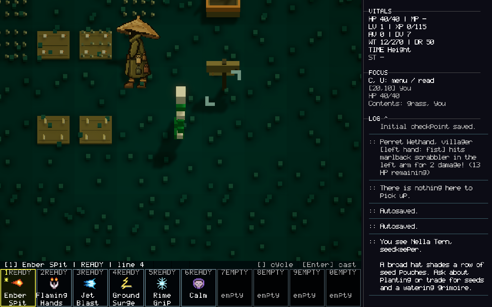

# Seed Keeper — Blender flat character

Status: historical detailed artwork, implemented and verified in Unity on 2026-10-18.
The user subsequently selected the native 16×24 Seed Keeper 3; see
[the current integration](SEED-KEEPER-16X24-ART.md). This Blender source and its
rebuild command remain available as an alternative.

Original implementation record: The existing `SpreadSeedKeeper` trader uses a planar character based on the right-hand supplied reference. World art and Examine share the same source; gameplay identity, stock and population are unchanged.

## Verification sweep

| Assumption | Verified result and decision |
| --- | --- |
| Blender MCP might be available | Blender 5.2.1 is installed; no Blender MCP tool was exposed. Run Blender background Python to create editable geometry. |
| A new NPC might be needed | The real seed trader already exists. Seed 64 generates it at Overworld.11.8.0, cell (19,9). No population or blueprint edits. |
| Replace the old humanoid prefab directly | The strict humanoid library requires 9 bones and 5 clips. Preserve it and add an exact keeper-only flat override in central model lookup. |
| Flat meshes can use normal facing and picking | Action facing could turn the body edge-on. Keep camera-facing rotation and use mesh-local picking bounds with 0.04 depth. |
| World and Examine share a camera | World pitch is 56 degrees; the portrait has its own camera. Orient the shared flat source separately in each view. |

Base main: `0408b6aa1`. Unity 6000.3.4f1, Metal; idle, clean SampleScene before testing.

## Design and implementation

The original planar artwork has an asymmetric woven straw hat, dark face and warm eye, olive scarf and coat, four seed pouches, gloves and brown boots. Highlights and shadow emphasis are painted with colored faces; no extrusion or cropped reference background.

- [Editable Blender source](../ArtSource/SeedKeeperFlat/seed-keeper.blend)
- [Blender preview](../ArtSource/SeedKeeperFlat/seed-keeper-preview.png) — source render, not gameplay.
- [Reproducible authoring script](../Tools/SeedKeeperFlat/build_blender.py)
- [Exported pixel and palette data](../Tools/SeedKeeperFlat/seed-keeper.json)

The source contains 1,724 occupied pixels, 36 palette entries and 6,896 coplanar vertices. Unity uses one shared mesh, one material and a point-filtered palette: 3,448 triangles, no per-pixel objects or added Update loop. Native fog and lighting remain active.

```csharp
CavesOfOoo.Editor.SeedKeeperFlatBuilder.Build(
    "Tools/SeedKeeperFlat/seed-keeper.json",
    "Docs/Verification/SeedKeeperFlat/import.json");
```

The .blend stays outside Assets to avoid automatic Blender imports. The builder creates the persistent prefab, mesh, palette and library in Assets/Resources/SeedKeeperFlat. The existing model ID and owner/glyph guards remain. The original rigged library is retained as a fallback if the optional flat library is absent.

## Validation

| Gate | Observed result |
| --- | --- |
| Initial RED | 9 cases: 4 expected missing-art/world/portrait/facing failures and 5 passing counter-checks. [Receipt](Verification/SeedKeeperFlat/red.json) |
| Initial GREEN | 109/109 actual Unity EditMode cases passed. [Receipt](Verification/SeedKeeperFlat/green-initial.json) |
| Review RED | 36 cases: 4 expected failures for inflated collider depth and altered vertex/swatch/winding. [Receipt](Verification/SeedKeeperFlat/review-red.json) |
| Final GREEN | 136/136 actual Unity EditMode cases passed, none skipped. [Receipt](Verification/SeedKeeperFlat/green-final.json) |
| Native play | Ordinary map travel and walking reached the generated keeper. The actual renderer submitted approved flat art. Keyboard Look → Examine and Chat → Trade opened successfully with existing stock. |
| Restoration | Play stopped, owned disposable saves cleaned, original LastGame and Game view restored, seed reset to 0, scene clean. [Receipt](Verification/SeedKeeperFlat/restoration.json) |

The final suite includes 36 keeper-focused/adversarial cases plus existing resident, humanoid, style, portrait, render-surface and model-lookup regressions. Counter-checks cover other residents, changed glyph/VisualID/portable ownership, hiding/removal, copied meshes, altered palettes and malformed source data. Every exported quad vertex, swatch and winding is validated.

## Actual game screenshots

Unedited 1280×800 Unity Game frames. The closer view temporarily uses GameplayZoomMultiplier 0.22 to show detail; shipped gameplay zoom is unchanged. [Capture dimensions and hashes](Verification/SeedKeeperFlat/captures.json) are authoritative; raw execute_code Screen dimensions can reflect Editor GUI context.



- [Ordinary world view](Verification/SeedKeeperFlat/world-native.png)
- [Examine portrait](Verification/SeedKeeperFlat/examine-native.png)
- [Existing seed shop](Verification/SeedKeeperFlat/trade-native.png)
- [World observer evidence](Verification/SeedKeeperFlat/world-native.json)

Reproduction: isolated seed 64, Shift+comma from spawn to the map, two map cells north, Shift+period into Overworld.11.8.0. Walk west to the stand at (19,9). Use L, cursor, Enter, X for Examine; Chat → Trade opens the shop. No teleports, NPC grants, gameplay-event injection or production-save mutation. The scene's full-reveal option was disabled only in the disposable session.

## Self-review and honesty bounds

- 🟡 Fixed: inverse-transformed world bounds produced a 1.329-deep click box. Exact local bounds and 0.04 depth remove that inflated picking volume.
- 🟡 Fixed: planarity and counts alone allowed changed art to pass validation. Exact source vertices, swatches and winding are now checked, with mutation tests.
- 🔵 Deliberate scope: one static illustrated pose with native movement interpolation; no new animation frames, other NPC redesigns or legacy 2D-renderer changes.
- 🔵 Existing UI observation: returning from Trade left the previous Look outline until L → Escape cleared it. Interaction worked; unrelated input cleanup is outside this art change.
- 🧪 Can verify: actual flat mesh, facing, visibility, picking, style approval, stock, normal keyboard interactions and save/view restoration. Captures were visually inspected for silhouette, shading and legibility.
- 🧪 Cannot claim: physical Steam Deck testing, all lighting/weather conditions, animation quality or pixel-perfect reference identity. Native world lighting darkens the palette; portrait lighting is brighter.
- Console UI showed zero errors/warnings. MCP's error filter mislabeled the ordinary Debug.Log("[Combat] Autosaved.") entry as Exception; its stack was the successful autosave publication path, with no exception message.

No Qud code or assets were used for this character. It follows the user's supplied reference. No scope divergence from Blender authoring, flat presentation, game integration and screenshot delivery.

## Files changed

New: ArtSource/SeedKeeperFlat, Tools/SeedKeeperFlat, runtime resources, SeedKeeperFlatLibrary.cs, SeedKeeperFlatBuilder.cs, two keeper test files and their .meta files, this document and verification receipts/screenshots.

Modified: SpawnRing prefab/spec lookup, presenter facing/materials/picking, style and voxel evidence, portrait facing, and the keeper branch of the existing field-resident rig test. No gameplay data or scene edits.
